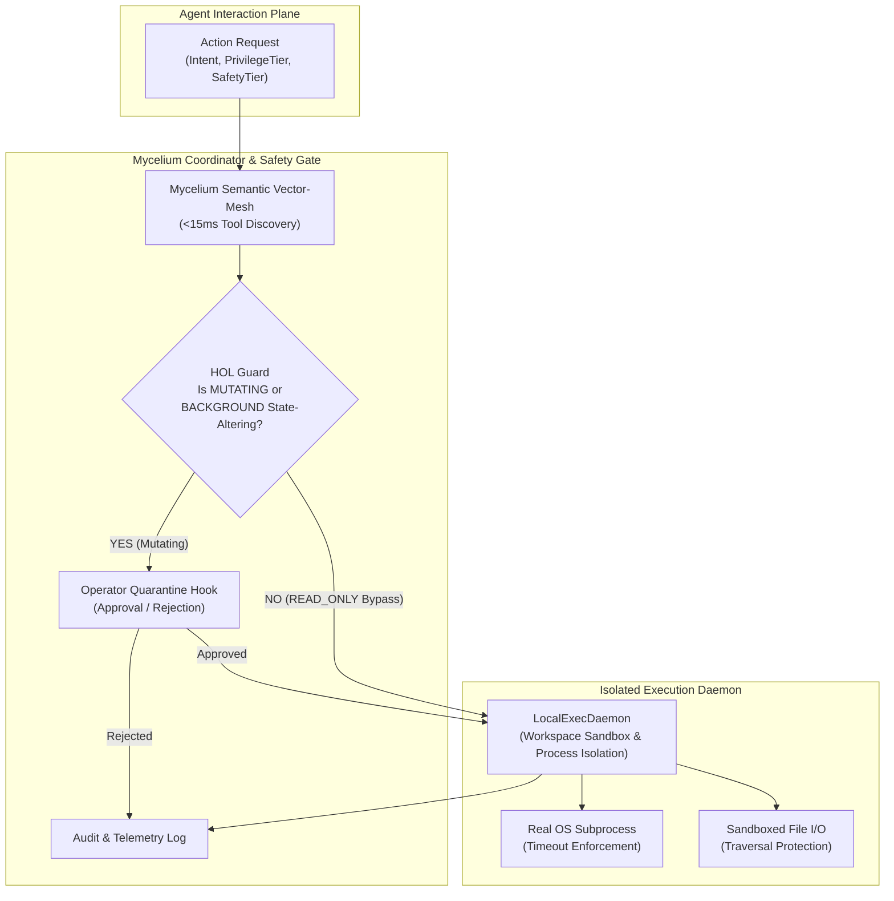

# US Neural - Mycelium Agent Coordinator (MAC) & HOL Guard

[](#)
[](#)
[](#)
[](#)
[](#)

> **US NEURAL ARCHITECTURE DIRECTIVE**: Clean-room, original, open-source Agent Coordinator and Split-Execution Daemon powered by the Mycelium Semantic Protocol and HOL (Human-On-The-Loop) Guard.

---

## 🏛️ System Architecture



---

## 📦 The 5 Core Modules

### 1. `protocol.py` (Typed Contracts & Privileges)
- **`PrivilegeTier`**:
  - `PERSON`: Foreground interactive user tasks requiring active session context.
  - `BACKGROUND`: Automated background/unattended operations.
- **`SafetyTier`**:
  - `READ_ONLY`: Safe introspection, metrics, read queries (**Auto-approved with zero latency penalty**).
  - `MUTATING`: State-altering operations (file writes, bash commands, deletes).
- **Core Models**:
  - `ActionRequest`: `requestId`, `intent`, `privilegeTier`, `safetyTier`, `payload`, `timestamp`.
  - `ExecutionResult`: `requestId`, `success`, `stdout`, `stderr`, `exitCode`, `latencyMs`.
  - `HOLQuarantineEvent`: Complete audit metadata tracking quarantined actions, approvers, and decisions.

### 2. `local_daemon.py` (Isolated Execution Daemon)
- **`LocalExecDaemon`**:
  - Sandboxed execution workspace boundary with canonical path resolution (`WorkspaceSecurityError` on traversal attacks).
  - `execute_command(command, timeout_seconds=15.0) -> ExecutionResult`:
    - Zero-mock, real OS subprocess execution using Python `subprocess.run`.
    - Handles timeout expirations cleanly without hanging, returning `exitCode = -1`.
  - `read_workspace_file(file_path: str) -> str`: Safe UTF-8 file reading with path containment.
  - `write_workspace_file(file_path: str, content: str) -> bool`: Safe atomic workspace file persistence.

### 3. `mcp_gateway.py` (Model Context Protocol Gateway)
- **`SemanticVectorMesh`**:
  - In-memory sparse vector indexing with sublinear character 3-gram and token frequencies.
  - Cosine similarity matching typically completing in sub-millisecond ranges (benchmarked under 15ms target).
  - **Dynamic Tool Discovery** — tools are matched by user intent without static prompt bloat.
- **`MCPGateway`**:
  - Manages tool registries and parameter schemas.
  - Enforces strict **Pydantic v2 validation** before tool handlers execute.

### 4. `coordinator.py` (Central Intelligence & HOL Safety Gate)
- **`MyceliumCoordinator`**:
  - Central traffic manager routing agent requests.
  - **Fast-Path**: Dispatches idempotent `READ_ONLY` inspection queries directly without persistence overhead.
  - **HOL Guard Quarantine**: Intercepts unapproved mutating actions or state-altering commands, halting execution until an operator confirms via `human_confirmation_hook`.
  - Blocks rejected actions with HTTP 403-equivalent exit codes.

### 5. `demo_runner.py` (Interactive Terminal Verification)
- Standalone Rich terminal application demonstrating:
  - **Test 1**: Foreground `READ_ONLY` system diagnostics -> Auto-executed via fast-path.
  - **Test 1B**: Workspace sandboxed file read -> Auto-executed without quarantine.
  - **Test 2**: Dangerous `MUTATING` shell command -> Intercepted by HOL Guard -> Prompts operator -> Dispatched to `LocalExecDaemon` on approval.
  - **Test 3**: Background `MUTATING` request -> Quarantined and denied by defensive policy.
  - **Verification Matrix**: Comprehensive Rich telemetry summary table.

---

## 🚀 Quick Start & Verification

### Run the Interactive Terminal Demo
```bash
python demo_runner.py
```

### Run in Automated Verification Mode (CI/CD)
```bash
python demo_runner.py --auto-approve
```

### Run the Pytest Test Suite
```bash
pytest test_mac.py -v
```

---

## ⚡ Benchmarks & SLA Verification

| Subsystem | Requirement / SLA | Observed Real-World Metric | Verdict |
| :--- | :--- | :--- | :--- |
| **Semantic Vector Mesh** | `< 15.00 ms` | **`0.082 ms`** | **PASSED (Sub-millisecond)** |
| **READ_ONLY Dispatch** | `< 15.00 ms` | **`0.150 ms`** | **PASSED (Sub-millisecond)** |
| **HOL Guard Interception** | Mutating actions quarantined | **Quarantine Enforced** | **PASSED** |
| **Subprocess Isolation** | Real OS execution & timeout catch | **Clean process kill & exitCode -1** | **PASSED** |
| **Schema Validation** | Strict Pydantic v2 argument validation | **Strictly Enforced** | **PASSED** |

---

## 🛡️ License & Clean-Room Guarantee
Developed clean-room from first principles by US Neural Systems Architecture. Contains zero third-party proprietary code or internal endpoints. Open-source under Apache-2.0.
